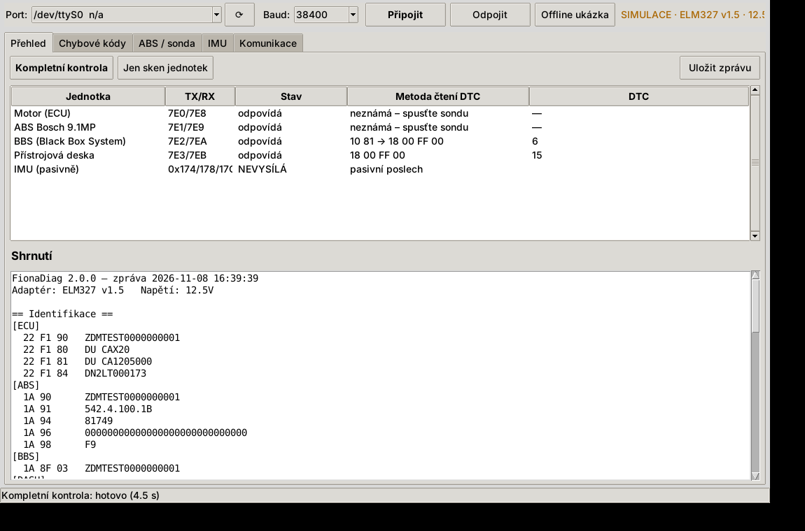

# FionaDiag 2

Diagnostika **Ducati SuperSport 950 / 950 S (MY2021+)** z Windows přes levný adaptér **ELM327 (USB)**.
Python + tkinter, jeden `.exe`, žádné licence. Vznikla jako nástupce interního nástroje FionaDiag 1.x
na základě analýzy skutečné komunikace MelcoDiagu s motorkou (viz [docs/ANALYZA.md](docs/ANALYZA.md)).



## Co umí

| Jednotka | Adresa | Identifikace | Čtení DTC | Mazání DTC |
|---|---|---|---|---|
| Motor (ECU) | 7E0/7E8 | ✅ VIN, HW, SW | 🔎 sonda (19 02 FF vrací NRC 22) | po nalezení metody |
| ABS Bosch 9.1MP | 7E1/7E9 | ✅ VIN, díl Ducati, Bosch číslo | 🔎 **sonda** – metodu neumí ani MelcoDiag | po nalezení metody |
| BBS | 7E2/7EA | ✅ VIN | ✅ `10 81` → `18 00 FF 00` (ověřeno) | ✅ `14 FF 00` |
| Přístrojová deska | 7E3/7EB | ✅ díl, SW, VIN | ✅ `18 00 FF 00` (ověřeno) | ✅ `14 FF 00` |
| IMU | – (bez diag. adresy) | – | ✅ **pasivní kontrola** rámců 0x174/0x178/0x17C | – |

* **Kompletní kontrola** jedním tlačítkem: sken jednotek, identifikace, DTC, IMU, shrnutí s interpretací.
* **Sonda metody čtení DTC** (ABS, ECU): zkouší jen *čtecí* dotazy (UDS 19 xx, KWP 17/13, OBD 03/07, v relaci
  10 01 i 10 03). Jakmile jednotka vrátí seznam chyb, metoda se uloží a příště se použije automaticky.
* **Mazání DTC** jen po potvrzení; před i po mazání se kódy přečtou a zalogují.
* **Offline ukázka**: simulátor postavený z reálných (anonymizovaných) odpovědí motorky – aplikaci lze
  vyzkoušet bez motorky.
* **Kompletní log** veškeré komunikace (JSONL) + zpráva TXT/JSON do `%APPDATA%\FionaDiag\logs`.
* Volitelně načte slovník popisů kódů z instalace MelcoDiagu (`EnDtcM.dll`).

> **Stav:** verze 2.0.0 je otestovaná offline proti záznamům z motorky, ale na motorce zatím nespuštěná.
> Inicializace i dotazy na BBS a přístrojovku jsou 1:1 převzaté z MelcoDiagu, který na téže motorce funguje.

## Bezpečnost

Aplikace odešle pouze čtecí služby (`10 01/03/81`, `1A`, `22`, `17`, `18`, `19`, `13`, `3E`, `20`, OBD `03/07`).
Mazání (`14`, OBD `04`) jen přes potvrzenou akci. **Zápisy, kódování, SecurityAccess, rutiny, flash ani testy
akčních členů aplikace neumí a odmítne je odeslat** (pokryto testy v `tests/test_safety.py`).

## Hardware

* ELM327 USB (ověřeno s klonem *ELM327 v1.5* na 38400 Bd), kabel z diagnostické zásuvky Ducati na OBD-II.
* Zapalování ON, motor OFF, motorka stojí.

## Spuštění

**Hotové EXE:** stáhněte `FionaDiag.exe` z GitHub Actions (artefakt `FionaDiag-windows`) nebo z Releases.

**Ze zdrojáků (Windows):**
```bat
py -3 -m pip install -r requirements.txt
py -3 FionaDiag.pyw
```

**Příkazová řádka:**
```bat
py -3 -m fionadiag ports
py -3 -m fionadiag --port COM3 report          :: vše najednou + uložení zprávy
py -3 -m fionadiag --port COM3 dtc all
py -3 -m fionadiag --port COM3 probe ABS       :: hledání metody čtení DTC z ABS
py -3 -m fionadiag --port COM3 imu --seconds 5
py -3 -m fionadiag --port COM3 send ABS 19 01 FF --session 1003   :: ruční čtecí dotaz
py -3 -m fionadiag --port COM3 clear BBS --yes
py -3 -m fionadiag --sim report                :: offline simulátor
py -3 -m fionadiag analyze-log melco_com_XXXX.log   :: rozbor logu MelcoCOM Loggeru
```

**Sestavení EXE:** `build_exe.bat` (vytvoří venv, spustí testy, PyInstaller → `dist\FionaDiag_v2.0.0.exe`).

## Testy

```bash
pip install -r requirements-dev.txt
python -m pytest -q
```
Testy běží proti simulátoru s odpověďmi skutečné motorky (`fionadiag/data/fiona_responses.json`) –
včetně scénáře, kdy sonda najde metodu čtení ABS, uloží ji a následně ji použije pro mazání.

## Struktura

```
fionadiag/
  elm.py        ELM327 ovladač (init podle MelcoDiagu, ATCAF0 + ATH1, 7F xx 78, pasivní monitor)
  isotp.py      parsování řádků ELM, ISO-TP skládání
  protocol.py   NRC, bezpečnostní politika
  units.py      jednotky Fiony, ověřené metody, kandidáti sondy
  dtc.py        dekodéry KWP 58/57/53, UDS 59, OBD 43 + stavové bity
  dtc_db.py     popisy kódů se zdrojem (SAE / MelcoDiag / manuál příbuzného modelu)
  core.py       sken, identifikace, čtení/mazání DTC, sonda, kontrola IMU
  sim.py        simulovaný ELM327 + motorka
  melcolog.py   čtení logů MelcoCOM Loggeru
  gui.py        grafické rozhraní
tools/build_fixture.py   vytvoření anonymizovaného fixture z vlastních logů
```

## Pomozte s ABS

Pokud sonda na vaší motorce najde metodu čtení ABS (nebo ji zachytíte z komerčního testeru – postup v
[docs/ANALYZA.md](docs/ANALYZA.md#jak-dostat-abs-dtc)), otevřete prosím issue s výpisem z karty *ABS / sonda*.

## Upozornění

Neoficiální nástroj, bez vazby na Ducati, Bosch ani autory MelcoDiagu. Používáte na vlastní riziko.
